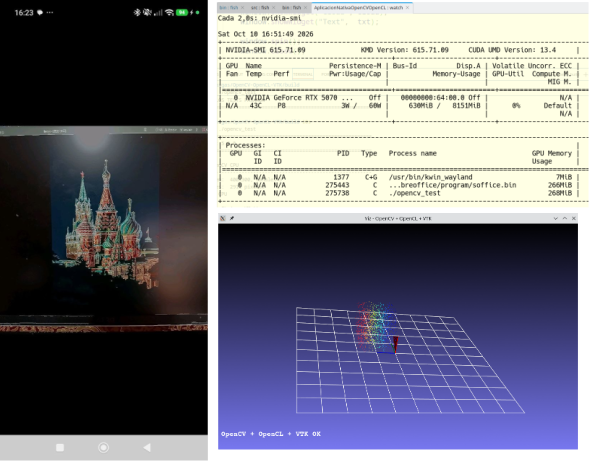
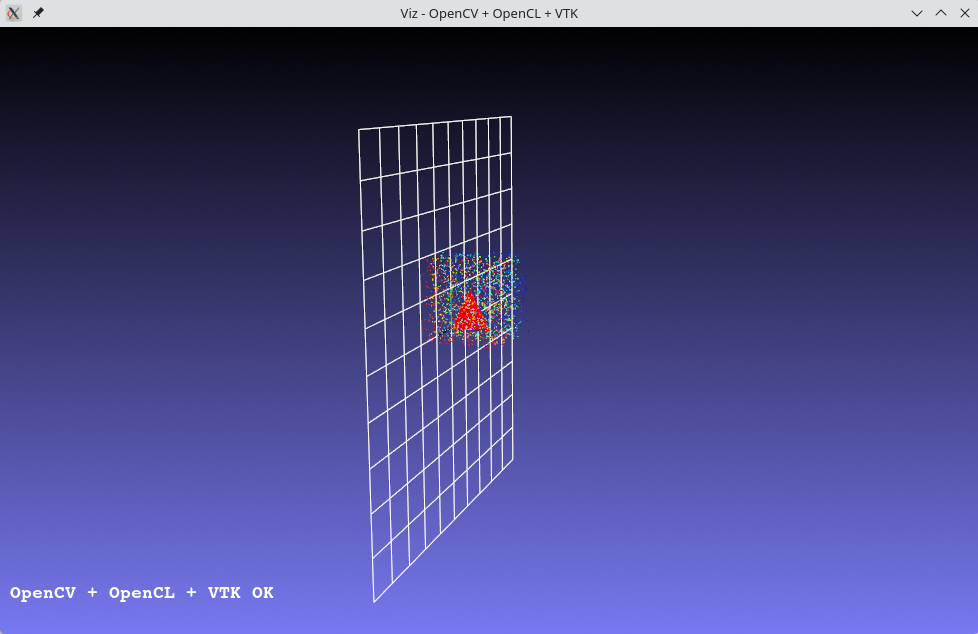

# Computer Vision on Android with OpenCV and OpenCL

A native Android application written in C++ that combines OpenCV image processing with OpenCL GPU acceleration to perform real-time edge detection on live camera frames.



---

## Table of Contents

- [Overview](#overview)
- [Features](#features)
- [Requirements](#requirements)
- [Project Structure](#project-structure)
- [Getting Started](#getting-started)
  - [1. Clone the Repository](#1-clone-the-repository)
  - [2. Open the Project in Android Studio](#2-open-the-project-in-android-studio)
  - [3. Verify the OpenCV Module Path](#3-verify-the-opencv-module-path)
  - [4. Build and Run](#4-build-and-run)
- [How It Works](#how-it-works)
  - [Java Layer](#java-layer)
  - [Native Layer](#native-layer)
  - [JNI Bridge](#jni-bridge)
- [Verifying OpenCL on the Device](#verifying-opencl-on-the-device)
- [Native Source Files](#native-source-files)
  - [CMakeLists.txt](#cmakeliststxt)
  - [native-lib.cpp](#native-libcpp)
  - [MainActivity.java](#mainactivityjava)
  - [activity_main.xml](#activity_mainxml)
- [Troubleshooting](#troubleshooting)
- [Related Content](#related-content)
- [License](#license)
- [Author](#author)

---

## Overview

This repository contains the complete source code and documentation for an Android application that processes camera frames on the GPU using OpenCV and OpenCL. Each frame captured by the device camera is transferred to the native C++ layer through JNI, converted to a `cv::UMat`, and processed with a pipeline that includes grayscale conversion, Gaussian blur, Canny edge detection, and a weighted blend of the edges with the original color image. The result is displayed back on the screen in real time.

The application is designed as a teaching example. It demonstrates how to:

- Integrate the OpenCV Android SDK as a local Gradle module.
- Set up the Android NDK and CMake to compile native C++ code.
- Use `JavaCameraView` to capture frames from the device camera.
- Exchange `cv::Mat` objects between Java and C++ without unnecessary copies.
- Run OpenCV operations on the GPU through the `cv::UMat` interface.
- Fall back to the CPU implementation when OpenCL is not available.

This project is part of a broader tutorial that also covers the compilation of OpenCV from source on a GNU/Linux system (CachyOS / Arch Linux) with support for CUDA, cuDNN, TBB, VTK and OpenCL, and includes a desktop C++ example that combines OpenCV, OpenCL and VTK for 3D visualization.



---

## Features

- Native Android application with C++ core.
- Real-time camera capture through `JavaCameraView`.
- GPU-accelerated image processing with OpenCL via `cv::UMat`.
- Automatic fallback to CPU when OpenCL is unavailable.
- Minimal JNI bridge that avoids unnecessary memory copies.
- Integration of the OpenCV Android SDK as a local Gradle module.
- Ready to compile with Android Studio Rabbit 1 and Android NDK 30.

---

## Requirements

| Component | Version |
|-----------|---------|
| Android Studio | Rabbit 1 (2026.1) or newer |
| Android SDK | API 37 (compileSdk), API 24 (minSdk) |
| Android NDK | 30.0.16248370 or newer |
| CMake | 3.22.1 or newer |
| OpenCV Android SDK | 4.14.0 |
| JDK | OpenJDK 27 (or the version bundled with Android Studio) |
| Device | Physical Android device with OpenCL support (recommended) |

> **Note:** OpenCL is not available on most Android emulators. To test the GPU acceleration path, use a physical device with a Qualcomm, ARM Mali or PowerVR chipset.

---

## Project Structure

```
.
├── app/                                  # Android application module
│   ├── build.gradle.kts
│   └── src/main/
│       ├── AndroidManifest.xml
│       ├── cpp/                          # Native C++ sources
│       │   ├── CMakeLists.txt
│       │   └── native-lib.cpp
│       ├── java/
│       │   └── ups/giiata/aplicacionnativaopencvopencl/
│       │       └── MainActivity.java
│       └── res/layout/
│           └── activity_main.xml
├── opencv/                               # OpenCV Android SDK (bundled)
│   ├── java/
│   ├── native/
│   └── build.gradle
├── docs/                                 # Tutorial, images and video
│   ├── assets/
│   │   └── opencv-opencl-vtk-demo.png
│   ├── video/
│   │   └── demo.mp4
│   ├── TUTORIAL.md
│   └── TUTORIAL.es.md
├── build.gradle.kts
├── settings.gradle.kts
├── gradle.properties
├── .gitignore
├── LICENSE
├── README.md
└── README.es.md
```

---

## Getting Started

### 1. Clone the Repository

```bash
git clone https://github.com/vlarobbyk/Computer-Vision-on-Android-with-OpenCV-and-OpenCL.git
cd Computer-Vision-on-Android-with-OpenCV-and-OpenCL
```

### 2. Open the Project in Android Studio

Launch Android Studio and select **Open**. Navigate to the cloned directory and select the root folder. Android Studio will detect the Gradle project and start the synchronization process.

During the first sync, Android Studio will download the required Gradle version and the project dependencies. Wait until the process finishes.

### 3. Verify the OpenCV Module Path

The OpenCV Android SDK is included in the `opencv/` directory of the repository. The project references it through a relative path in `settings.gradle.kts`:

```kotlin
include(":app")
include(":opencv")

project(":opencv").projectDir = file("opencv")
```

If the module is not found, verify that the `opencv/` directory contains the SDK contents (`java/`, `native/`, `build.gradle`).

### 4. Build and Run

1. Connect a physical Android device with USB debugging enabled.
2. Press **Run** (Shift + F10) in Android Studio.
3. The application will request camera permissions on first launch. Grant them.
4. Point the camera at any scene. The application displays the original frame blended with the Canny edges, processed on the GPU.

> **Note:** If the device does not support OpenCL, the application automatically uses the CPU implementation. The result is visually similar, but the performance is lower.

---

## How It Works

The application is organized in three layers that communicate through JNI.

### Java Layer

`MainActivity.java` extends `CameraActivity` (provided by the OpenCV SDK) and implements `CameraBridgeViewBase.CvCameraViewListener2`. This interface exposes three methods:

- `onCameraViewStarted(int width, int height)`: allocates the output `Mat` with the size of the camera preview.
- `onCameraViewStopped()`: releases the output `Mat` when the camera stops.
- `onCameraFrame(CameraBridgeViewBase.CvCameraViewFrame inputFrame)`: called for every captured frame. It retrieves the RGBA frame and calls the native function `processFrameOpenCL`, passing the memory addresses of the input and output `Mat` objects.

The native library is loaded once through a static block:

```java
static {
    if (OpenCVLoader.initLocal()) {
        System.loadLibrary("aplicacionnativaopencvopencl");
    }
}
```

### Native Layer

`native-lib.cpp` implements the function `processFrameOpenCL` with the JNI naming convention. It receives two `jlong` values that correspond to the memory addresses of the input and output `cv::Mat` objects. These are cast to references:

```cpp
cv::Mat& mColor = *(cv::Mat*)addrRgba;
cv::Mat& mOut = *(cv::Mat*)addrOut;
```

The processing pipeline runs entirely on the GPU through the `cv::UMat` interface:

```cpp
cv::UMat uRgba = mColor.getUMat(cv::ACCESS_READ);
cv::UMat uGray, uBlur, uEdges, uEdgesColor, uBorders;

cv::cvtColor(uRgba, uGray, cv::COLOR_RGBA2GRAY);
cv::GaussianBlur(uGray, uBlur, cv::Size(5, 5), 0);
cv::Canny(uBlur, uEdges, 50, 150);
cv::cvtColor(uEdges, uEdgesColor, cv::COLOR_GRAY2RGBA);
cv::addWeighted(uRgba, 0.5, uEdgesColor, 0.5, 0.0, uBorders);

uBorders.copyTo(mOut);
```

OpenCL is enabled explicitly at the beginning of the function:

```cpp
cv::ocl::setUseOpenCL(true);
__android_log_print(ANDROID_LOG_INFO, "OpenCV_Tutorial",
                    "OpenCL disponible y activado: %d", cv::ocl::useOpenCL());
```

If OpenCL is not available, OpenCV transparently falls back to the CPU implementation.

### JNI Bridge

The bridge between Java and C++ is defined by the native method:

```java
public native void processFrameOpenCL(long matAddrRgba, long matAddrOut);
```

The corresponding C++ function follows the JNI naming convention:

```cpp
extern "C" JNIEXPORT void JNICALL
Java_ups_giiata_aplicacionnativaopencvopencl_MainActivity_processFrameOpenCL(
    JNIEnv *env, jobject /* this */, jlong addrRgba, jlong addrOut)
```

No data is copied between Java and C++. Only the memory addresses of the two `Mat` objects are passed, which keeps the per-frame overhead minimal.

---

## Verifying OpenCL on the Device

To confirm that OpenCL is active during execution, monitor the device log with `adb`:

```bash
adb logcat | grep OpenCV_Tutorial
```

Expected output:

```
I/OpenCV_Tutorial: OpenCL disponible y activado: 1
```

If the value is `0`, OpenCL is not available on the device and the application runs on the CPU.

---

## Native Source Files

### CMakeLists.txt

```cmake
cmake_minimum_required(VERSION 3.22.1)

project("aplicacionnativaopencvopencl")

set(OpenCV_DIR "${CMAKE_SOURCE_DIR}/../../../opencv/sdk/native/jni")

find_package(OpenCV REQUIRED)

add_library(${CMAKE_PROJECT_NAME} SHARED
        native-lib.cpp)

target_link_libraries(${CMAKE_PROJECT_NAME}
        ${OpenCV_LIBS}
        android
        log)
```

> **Note:** The `OpenCV_DIR` variable must point to the `native/jni` directory of the OpenCV Android SDK. When the SDK is bundled inside the project (`opencv/`), use a relative path. When the SDK is external, use an absolute path.

### native-lib.cpp

```cpp
#include <jni.h>
#include <string>
#include <opencv2/core.hpp>
#include <opencv2/core/ocl.hpp>
#include <opencv2/imgproc.hpp>
#include <android/log.h>

extern "C" JNIEXPORT jstring JNICALL
Java_ups_giiata_aplicacionnativaopencvopencl_MainActivity_stringFromJNI(
        JNIEnv* env, jobject /* this */) {
    std::string hello = "Hello from C++";
    return env->NewStringUTF(hello.c_str());
}

extern "C" JNIEXPORT void JNICALL
Java_ups_giiata_aplicacionnativaopencvopencl_MainActivity_processFrameOpenCL(
        JNIEnv *env, jobject /* this */, jlong addrRgba, jlong addrOut) {
    cv::Mat& mColor = *(cv::Mat*)addrRgba;
    cv::Mat& mOut = *(cv::Mat*)addrOut;

    cv::ocl::setUseOpenCL(true);
    __android_log_print(ANDROID_LOG_INFO, "OpenCV_Tutorial",
                        "OpenCL disponible y activado: %d", cv::ocl::useOpenCL());

    cv::UMat uRgba = mColor.getUMat(cv::ACCESS_READ);
    cv::UMat uGray, uBlur, uEdges, uEdgesColor, uBorders;

    cv::cvtColor(uRgba, uGray, cv::COLOR_RGBA2GRAY);
    cv::GaussianBlur(uGray, uBlur, cv::Size(5, 5), 0);
    cv::Canny(uBlur, uEdges, 50, 150);
    cv::cvtColor(uEdges, uEdgesColor, cv::COLOR_GRAY2RGBA);
    cv::addWeighted(uRgba, 0.5, uEdgesColor, 0.5, 0.0, uBorders);

    uBorders.copyTo(mOut);
}
```

### MainActivity.java

```java
package ups.giiata.aplicacionnativaopencvopencl;

import android.Manifest;
import android.content.pm.PackageManager;
import android.os.Bundle;
import androidx.core.app.ActivityCompat;
import androidx.core.content.ContextCompat;

import org.opencv.android.CameraActivity;
import org.opencv.android.CameraBridgeViewBase;
import org.opencv.android.OpenCVLoader;
import org.opencv.core.Mat;
import org.opencv.core.CvType;

import java.util.Collections;
import java.util.List;

public class MainActivity extends CameraActivity
        implements CameraBridgeViewBase.CvCameraViewListener2 {

    private CameraBridgeViewBase mCameraView;
    private Mat mOutputMat;

    static {
        if (OpenCVLoader.initLocal()) {
            System.loadLibrary("aplicacionnativaopencvopencl");
        }
    }

    public native void processFrameOpenCL(long matAddrRgba, long matAddrOut);

    @Override
    protected void onCreate(Bundle savedInstanceState) {
        super.onCreate(savedInstanceState);
        setContentView(R.layout.activity_main);

        if (ContextCompat.checkSelfPermission(this, Manifest.permission.CAMERA)
                != PackageManager.PERMISSION_GRANTED) {
            ActivityCompat.requestPermissions(this,
                    new String[]{Manifest.permission.CAMERA}, 1);
        }

        mCameraView = findViewById(R.id.camera_view);
        mCameraView.setCvCameraViewListener(this);
        mCameraView.enableView();
    }

    @Override
    public void onCameraViewStarted(int width, int height) {
        mOutputMat = new Mat(height, width, CvType.CV_8UC4);
    }

    @Override
    public void onCameraViewStopped() {
        if (mOutputMat != null) mOutputMat.release();
    }

    @Override
    public Mat onCameraFrame(CameraBridgeViewBase.CvCameraViewFrame inputFrame) {
        Mat rgba = inputFrame.rgba();
        processFrameOpenCL(rgba.getNativeObjAddr(), mOutputMat.getNativeObjAddr());
        return mOutputMat;
    }

    @Override
    protected List<? extends CameraBridgeViewBase> getCameraViewList() {
        return Collections.singletonList(mCameraView);
    }
}
```

### activity_main.xml

```xml
<?xml version="1.0" encoding="utf-8"?>
<RelativeLayout
    xmlns:android="http://schemas.android.com/apk/res/android"
    android:layout_width="match_parent"
    android:layout_height="match_parent">

    <org.opencv.android.JavaCameraView
        android:id="@+id/camera_view"
        android:layout_width="match_parent"
        android:layout_height="match_parent"
        android:visibility="visible" />
</RelativeLayout>
```

---

## Troubleshooting

### The application crashes on launch with `UnsatisfiedLinkError`

Verify that the library name in `System.loadLibrary("...")` matches the project name declared in `CMakeLists.txt`. Both should be `aplicacionnativaopencvopencl`.

### OpenCV module is not found during Gradle sync

Confirm that the `opencv/` directory contains the SDK contents and that `settings.gradle.kts` includes:

```kotlin
include(":opencv")
project(":opencv").projectDir = file("opencv")
```

### Camera preview does not appear

The application requires the `CAMERA` permission. Verify that it is declared in `AndroidManifest.xml` and granted at runtime. On Android 6.0 and above, the permission must be requested dynamically.

### `OpenCL disponible y activado: 0` in the log

The device does not support OpenCL, or the OpenCL driver is not accessible to the application. The processing falls back to the CPU, and the result is still correct.

### Camera stops working after closing the application

Verify that `onDestroy()` calls `mCameraView.disableView()`:

```java
@Override
protected void onDestroy() {
    super.onDestroy();
    if (mCameraView != null) {
        mCameraView.disableView();
    }
}
```

### Gradle sync fails with `AccessDeniedException` on Linux

This occurs when the OpenCV module path points to a protected directory such as `/opt` or `/usr`. Move the SDK to a directory inside your home folder, or bundle it inside the project as described in the [Project Structure](#project-structure) section.

---

## Related Content

This repository is part of a broader tutorial on computer vision with hardware acceleration. The desktop part covers:

- Compilation of OpenCV 4.14.0 from source on Arch Linux (CachyOS).
- CUDA 13.4 and cuDNN 9.27 integration for the DNN module.
- OpenBLAS / LAPACK support with a local patch for the OpenBLAS CMake configuration.
- FFmpeg 9 compatibility patch for the `videoio` module.
- VTK 9.6 integration for the `viz` module.
- A desktop C++ example that combines OpenCV, OpenCL and VTK for 3D visualization.

The complete tutorial is available in the `docs/` directory:

- [English tutorial](docs/TUTORIAL.md)
- [Tutorial en español](docs/TUTORIAL.es.md)

---

## License

Distributed under the MIT License. See the `LICENSE` file for details.

---

## Author

Vladimir Robles Bykbaev - [vlarobbyk](https://github.com/vlarobbyk)